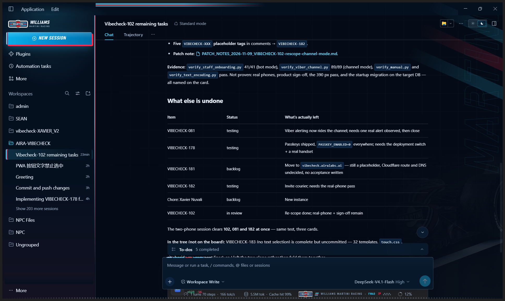
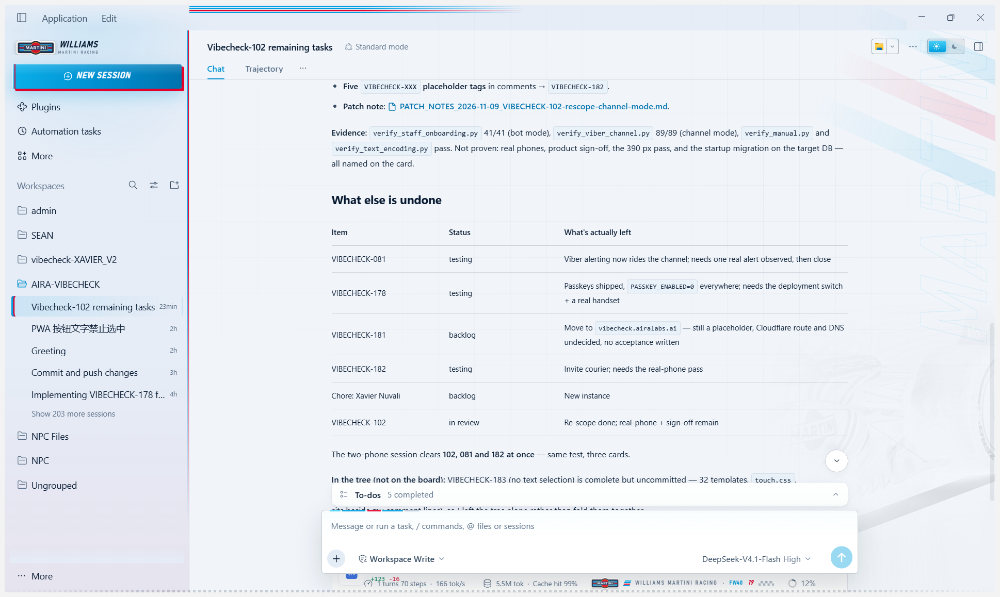
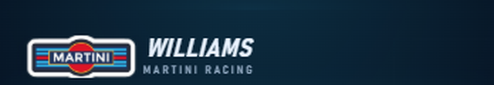
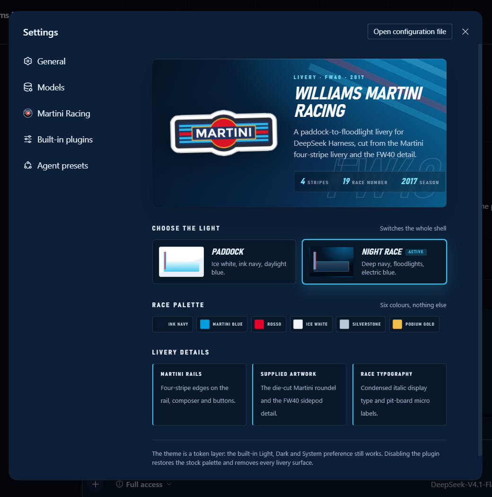
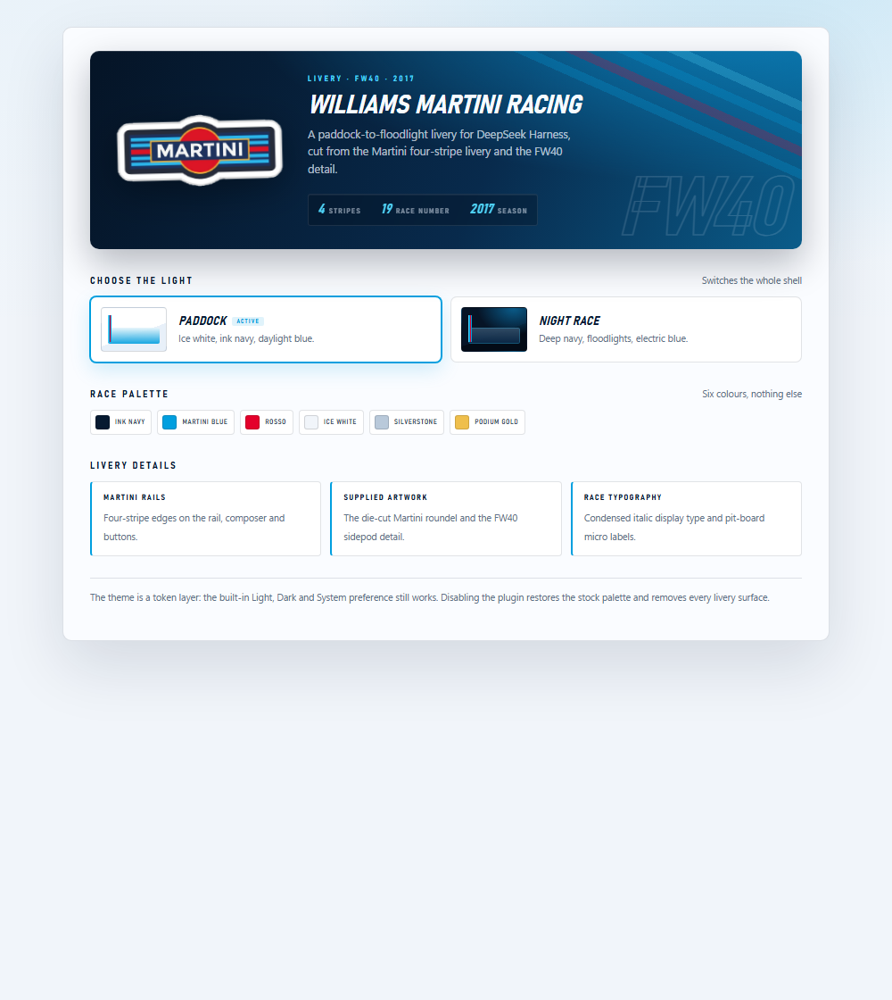

# Williams Martini Racing theme for DeepSeek Harness

A complete client-side livery for the DSH Web UI, cut from the supplied Martini
die-cut logo and the FW40 sidepod photograph: ink navy and ice white, Martini
four-stripe rails, an FW40 corner ghost, a pit-board day/night switch, and a
Martini Racing settings page.











The two app captures, the lockup crop and the dark settings capture are live app
screenshots; the light settings page is rendered from the same component markup
and token table by `tools/preview-settings.mjs` so the daylight card layout can
be inspected at a fixed size.

## What it changes

- **Both palettes, complete.** Every alias token is supplied for Light and
  Dark. Paddock daylight is ice white and ink navy; Night race is deep navy with
  floodlight blue. The built-in Light, Dark and System preference keeps working.
- **The supplied logo, four ways.** The logo is flood-cut from its grey field
  with the white die-cut border intact, then used as the hero sticker, the
  sidebar brand mark, the pit-wall plate, and the plugin icon. The horizontal
  MARTINI wordmark is never redrawn.
- **Martini rails, everywhere.** Four-stripe edges run down the sidebar, across
  the composer, inside the New Session button, along the window top, and under
  the pit strip. The stripes are drawn in CSS so they stay crisp at any scale.
- **Sidebar lockup.** The supplied die-cut sticker replaces the product mark;
  the brand row reads `WILLIAMS` / `MARTINI RACING` in condensed italic display
  type beside it.
- **Empty-state hero.** The supplied sticker sits above the headline with an
  `FW40 · 2017 · №19` race-code caption, while an oversized outlined
  `WILLIAMS` ghost fills the empty right side.
- **FW40 canvas ghost.** The supplied car detail is graded for each scheme — a
  navy-toned positive at night, a paper negative for multiply in daylight — and
  feathered into the bottom-right corner. A diagonal livery band, a vertical
  MARTINI wall decal, a blueprint grid and a finish-line checker complete the
  layer.
- **Pit-board switch.** The session-header switch is a compact day/night pit
  board with sun and moon segments and a sliding blue thumb. It writes the
  normal Light/Dark preference, so the choice persists and the Appearance
  controls stay in sync.
- **Martini Racing settings page.** A full settings section with the supplied
  logo, the FW40 watermark, live Paddock/Night Race cards, the six-colour race
  palette, and three livery notes.
- **Pit-wall strip.** A supplied-logo plate under the composer reads
  `WILLIAMS MARTINI RACING · FW40 · 19` with a four-bar flag and finish checker.
- **Race typography and chrome.** Condensed italic display type, uppercase
  micro-labels, sharpened radii, blue focus rings, blue scrollbars, a white
  race-plate composer with a stripe rule, a blue New Session plate with a red
  offset shadow, and a red send button.

## Install

From the DSH Web GUI: **Plugins → Add plugin → local directory path**, enter
this directory, then choose **Install → Enable now**. Or use `plugin_manager`
with `action: install_bundle` and this directory as the `target`.

Only one theme should be enabled at a time: themes are token override layers
over the same aliases, so a second enabled theme will fight this palette. Enable
this bundle and disable any other theme bundle in Plugin Manager.

## Build

`client.js` is generated. Edit `client.template.js`, then run:

```powershell
python assets/build_assets.py     # logo cut-out, car grades, base64 payloads
python assets/build_icon.py       # 256px plugin-manager icon
node tools/inline-assets.mjs      # inline payloads into client.js and icon.svg
node tools/preview-settings.mjs   # optional: static settings-page preview
```

`assets/build_assets.py` reads `assets/source-logo.png` and
`assets/source-car.png` (the supplied files) and writes the transparent logo,
the two car grades and their `.b64` copies. `client.js` embeds those payloads as
data URLs because a Web Client plugin is a single script. `icon.png` is the
display resource used by Plugin Manager; `icon.svg` is kept as the vector
source for the README.

## Files

| File | Role |
|---|---|
| `index.js` | Host half; empty plugin row that keeps the bundle mounted. |
| `client.js` | Generated client half: tokens, stylesheet, artwork, slots. |
| `client.template.js` | Source of `client.js`; the file to edit. |
| `cordis.patch.yml` | Bundle patch that inserts `williams-martini-theme`. |
| `icon.png` | Plugin Manager artwork: the die-cut logo on a navy tile. |
| `icon.svg` | Vector version of the same tile. |
| `locale/en.json`, `locale/zh.json` | Plugin Manager title and description. |
| `assets/` | Supplied artwork, build scripts and base64 payloads. |
| `tools/` | Build, capture and UI-automation helpers; not shipped at runtime. |
| `preview/` | Live captures and one rendered settings preview; not shipped at runtime. |

## Verification

Verified against the running DSH Web client at 1938×1158 and 1441×909:

- the theme applies in both Night race and Paddock daylight; the header
  pit-board switch was exercised live and wrote the normal Light/Dark
  preference, and the settings cards expose the same two choices;
- the hero sticker, sidebar lockup, settings icon, pit strip, stripe rails,
  composer rule, New Session plate, user bubble and finish line render in both
  schemes;
- the `Martini Racing` settings section opens from the Settings nav with its
  own icon and renders the banner, both mode cards, the six palette chips and
  the three livery notes; the light variant is reproduced from the same markup
  and CSS in `preview/settings-light.png`;
- the plugin icon and localized metadata are present in the package, and the
  bundle is active in the profile at hand-off.

Rendered appearance can still vary with window size and host build. The theme
reaches undocumented chrome through class fragments (`[class*="sidebarCol"]`,
`[data-composer-card]`, `[class*="newSession"]`, `[class*="fishHitbox"]`,
`[class*="marks"]`) plus the documented slots (`sidebar.brand.mark`,
`sidebar.brand.name`, `conversation.hero.brand.mark`,
`conversation.composer.dock`, `conversation.session.header.utilities`,
`settings.section`, `settings.section.icon`). If a future build renames one of
those hooks, only that flourish disappears; the palette, artwork and slots keep
working.

## Notes

Williams, Martini and the Martini Racing livery are trademarks of their
respective owners. This is an unofficial personal theme built from the artwork
supplied for this project; it is not affiliated with Williams Racing or Martini.
